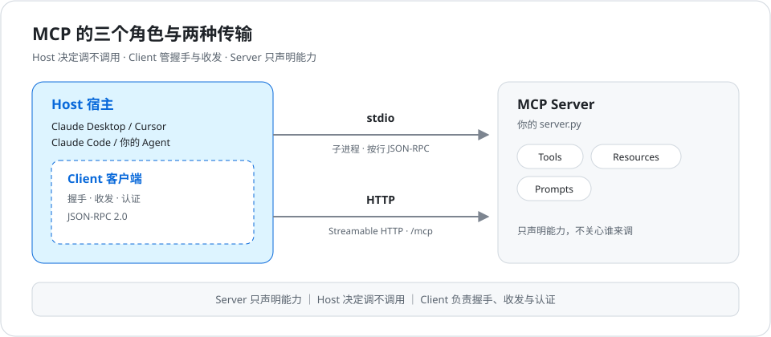

# FastMCP 4.2 从 0 到 1

[](https://github.com/xiaowang018/fastmcp-learning/actions/workflows/ci.yml)
[](LICENSE)
[](pyproject.toml)

一套能跑、能测、能查的中文 FastMCP 学习案例库：**22 个编号目录，一个目录一个案例**，每个案例都有代码、md 教程、一键自测和 pytest 测试。



图：22 个案例都在这条链路的某一环上。

## 0. 准备（约 5 分钟，只做一次）

### 0.1 你需要什么

| 需要会 | 不需要会 |
|---|---|
| 函数、类型注解 `a: int`、`async/await` 基础、JSON | MCP 协议、FastMCP、Pydantic 高级用法、Docker |

Python 3.11+ 由 uv 按 `.python-version` 自动下载，不需要手动安装。前 9 个案例全部离线可跑，不需要 API key。

### 0.2 安装 uv

`uv` 是本仓库唯一的安装入口：它负责下载 Python、创建 `.venv`、装依赖。

Windows（开始菜单搜索 PowerShell）：

```powershell
powershell -ExecutionPolicy ByPass -c "irm https://astral.sh/uv/install.ps1 | iex"
```

macOS / Linux：

```bash
curl -LsSf https://astral.sh/uv/install.sh | sh
```

装完**重开终端**，执行 `uv --version`。提示「找不到 uv」说明 PATH 没刷新；仍不行看 [docs/04 §1](docs/04-troubleshooting.md#1-环境与安装)。

### 0.3 拿到代码

```bash
git clone https://github.com/xiaowang018/fastmcp-learning.git
cd fastmcp-learning
```

没有 Git：在仓库页点 `Code` → `Download ZIP`，解压后的目录通常叫 `fastmcp-learning-main`，`cd` 时换成实际目录名。

后文所有 `uv` 命令都要在**仓库根目录**（含 `pyproject.toml` 的那一层）执行。

### 0.4 装依赖并自检

```bash
uv sync --all-groups
uv --version
uv run python -c "from importlib.metadata import version; print(version('fastmcp'))"
uv run pytest -q
```

`--all-groups` 一次装齐默认依赖 + dev + api + apps，避免后面来回切组。最后一条应为 `91 passed`；如果看到 `83 passed, 3 skipped`，说明只装了默认组，回到上一步重跑即可，不是失败。

### 0.5 平台支持与已知限制

| 平台 | 状态 |
|---|---|
| Windows 10/11（PowerShell / Git Bash） | 支持，CI 覆盖 |
| macOS 12+ | 支持，文档给 POSIX 写法 |
| Ubuntu 22.04+ | 支持，CI 覆盖 |
| Python 3.11 / 3.12 / 3.13 | 支持 |

已知限制：

- `fastmcp dev inspector` 需要 **Node.js 18+** 与网络（`npx` 下载 Inspector）；没装 Node 不影响 `client.py` 和 `pytest`。
- MCP Apps（0304）的交互 UI 需要支持 Apps 的宿主；仓库保证 UI 描述树与 HTML 降级页可跑，不提供界面截图。
- 裸 JSON-RPC 示例（0101 §5）在 Windows 需用 Git Bash；PowerShell 用户可跳过，不影响主线。

## 1. 15 分钟体验

```bash
cd 0101-hello-mcp
uv run python client.py
uv run pytest . -q
```

看到 `add(2, 3) = 5` 和 `3 passed` 就说明环境通了。然后读 0101 的「4. 关键概念」前两小节，再花 3 分钟看一眼[调用时序图](docs/00-mcp-in-10-minutes.md#3-一次工具调用的完整链路)。

接下来从 [`0101-hello-mcp/README.md`](0101-hello-mcp/README.md) 开始。

## 2. 22 个案例

### 01 基础篇：把 MCP 跑起来

| 编号 | 主题 | 核心内容 | 前置 |
|---|---|---|---|
| [0101](0101-hello-mcp/README.md) | 最小服务器 | 三通路对照、stdio、裸 JSON-RPC | — |
| [0102](0102-tool-schema/README.md) | 工具 schema | Annotated/Field、枚举、嵌套模型 | 0101 |
| [0103](0103-tool-output/README.md) | 返回值 | content / structuredContent / ToolResult / Image | 0102 |
| [0104](0104-tool-errors/README.md) | 失败五形态 | 校验、ToolError、异常、超时、取消 | 0103 |
| [0105](0105-resources/README.md) | 资源 | 静态/模板/通配/查询参数、路径安全 | 0103 |
| [0106](0106-prompts/README.md) | 提示 | 三种返回形态、参数校验、角色 | 0102 |
| [0107](0107-context/README.md) | 上下文 | 进度、日志、读资源、请求内状态 | 0105 0106 |
| [0108](0108-client-transports/README.md) | 连接与协议 | in-memory / stdio / HTTP、现代 vs legacy | 0107 |
| [0109](0109-client-advanced/README.md) | 客户端进阶 | 完整调用面、ClientGroup、最小 Host | **0107** 0108（概念） |

### 02 进阶篇：工程化

| 编号 | 主题 | 核心内容 | 前置 | 端口/依赖 |
|---|---|---|---|---|
| [0201](0201-http-server/README.md) | HTTP 部署 | run/http_app、/health、CORS、stateless | 0108 | 8101 |
| [0202](0202-lifespan-di/README.md) | 生命周期与 DI | lifespan 资源、清理、Depends | **0107 0201** | — |
| [0203](0203-middleware/README.md) | 中间件 | 钩子层级、配额、响应截断、顺序 | **0201 0202** | — |
| [0204](0204-auth-security/README.md) | 鉴权与安全 | Bearer、scope 可见性、401 三态 | 0201 0203 | 8104 |
| [0205](0205-compose-proxy/README.md) | 组合与代理 | mount/namespace、create_proxy、冲突 | **0109 0204** | — |
| [0206](0206-openapi-fastapi/README.md) | OpenAPI/FastAPI | from_fastapi、RouteMap、收敛 | 0205 | `api` 组 |
| [0207](0207-testing/README.md) | 测试 | 五类测试、schema 契约、markers | 0109 0202 | — |

### 03 实战篇：完整项目

| 编号 | 主题 | 核心内容 | 前置 | 端口/依赖 |
|---|---|---|---|---|
| [0301](0301-sqlite-crud/README.md) | SQLite 待办 | lifespan + 锁、分页、状态机、资源 | 01 篇 + 0202 | — |
| [0302](0302-rest-api-wrapper/README.md) | REST 包装 | httpx2、超时/重试、错误映射 | **0202** 0206（概念） | `api` 组，8107 |
| [0303](0303-docs-kb/README.md) | 知识库 | Resource + Tool + Prompt、可解释检索 | 0105 0106 0109 | — |
| [0304](0304-apps-ui/README.md) | MCP Apps | `app=True`、Prefab、HTML 降级 | 0103 0201 | `apps` 组，8080 |
| [0305](0305-deploy-install/README.md) | 部署与安装 | fastmcp.json、CLI install、Docker | 0201 0204 | 8109 |
| [0306](0306-agent-host/README.md) | 最小 Host | ClientGroup、确定性 planner、错误恢复 | **0109 0301** 0302（概念） | — |

> 图例：**粗体** = 硬前置（代码或环境直接依赖）；普通 = 概念前置（先读更好，不读也能跑）。本表是唯一事实源，案例页头部与本表保持一致。

<details>
<summary>目录结构与每个案例的四件套</summary>

```text
fastmcp-learning/
├─ README.md                 # 本文件：路线图 + 索引
├─ pyproject.toml            # 统一依赖与 pytest 配置
├─ helpers.py                # load_server / serve_asgi / serve_http
├─ docs/                     # 6 篇横向文档 + 3 张示意图
├─ scripts/verify_all.py     # 逐个跑 22 个 client.py
├─ 01xx-*                    # 基础篇 9 个
├─ 02xx-*                    # 进阶篇 7 个
└─ 03xx-*                    # 实战篇 6 个
```

| 文件 | 作用 |
|---|---|
| `README.md` | 教程：目标 / 跑起来 / 代码地图 / 讲解 / 验证 / 踩坑 / 差异 / 练习 |
| `server.py` | 服务端实现，可独立 `python server.py` 启动 |
| `client.py` | 一键自测，`uv run python client.py` 即可验证 |
| `test_server.py` | pytest 测试，覆盖正常、边界、错误与契约 |

部分案例追加 `data/`、`mock_api.py`、`fastmcp.json`、`Dockerfile`。

</details>

## 3. 学习路径

| 档位 | 内容 | 时长 |
|---|---|---|
| 15 分钟体验 | §0 + 0101 的 `client.py` + 关键概念 + 时序图 | 15 分钟 |
| 半日最小闭环 | 0101 → 0102 → 0105 → 0106 → 0107 → 0108；收尾 `pytest 01*` + `verify_all --only 01` | 约 3–3.5 小时 |
| 全量系统 | 01 → 02 → 03 顺序全做，5 天 × 3 小时；每篇结束跑 `verify_all --only 0X` | 约 15 小时 |

半日闭环跳过了 0103（返回值形态）、0104（失败五形态）、0109（客户端完整调用面）；它们是专题，遇到问题时再回读，不影响 0201 之后的进度。

**三天速成（约 8 小时）**：`0101 → 0102 → 0103 → 0105 → 0107 → 0108 → 0109 → 0201 → 0204 → 0303`。跳过 0104 / 0106 / 0202 / 0203 / 0205-0207 / 03 篇大部分，需要时单独回读。

**按角色跳读**

| 角色 | 建议路径 |
|---|---|
| 后端/平台 | 0101-0104 → 0107 → 0201-0205 → 0301/0302/0305 |
| 算法/数据 | 0102 0103 → 0109 → 0206 → 0302/0303/0306 |
| 前端/全栈 | 0105 0106 → 0201 0204 → 0304 |
| 只想接宿主 | 0101 → 0108 → [docs/02](docs/02-client-integration.md) |

角色路径是阅读顺序建议，不是硬依赖；冲突时以 §2 的粗体前置为准。

## 4. 常用命令

```bash
# 跑单个案例
cd 0104-tool-errors
uv run python client.py
uv run pytest . -q

# 跑某一篇（02/03 需要先 uv sync --all-groups）
uv run python scripts/verify_all.py --only 02
uv run pytest 02* -q

# 跑全量（需要先 uv sync --all-groups）
uv run python scripts/verify_all.py
uv run pytest -q
uv run ruff check .

# 查看服务能力
uv run fastmcp inspect 0101-hello-mcp/server.py
uv run fastmcp inspect 0305-deploy-install/fastmcp.json

# 手动起 HTTP
cd 0201-http-server && uv run python server.py
```

## 5. 运行约定

| 项 | 约定 |
|---|---|
| 端口 | 手动运行：8101=0201、8104=0204、8107=0302 mock、8108=0108、8109=0305；0304 的 `fastmcp dev apps` 用 8080；测试一律 `port=0` |
| 就绪判定 | 轮询 `/health`，不用 `sleep` |
| 编码 | 子进程 `PYTHONUTF8=1` / `PYTHONIOENCODING=utf-8` |
| stdout | 服务端日志只走 stderr；stdout 只能有 JSON-RPC |
| 路径 | `Client(Path("server.py"))`，不传字符串 |
| 超时 | 客户端 10s，pytest 单测 30s |
| 数据 | 案例自带的 `*.db` / `.env` 已在 `.gitignore` |

## 6. 横向文档

| 文档 | 内容 |
|---|---|
| [docs/00-mcp-in-10-minutes.md](docs/00-mcp-in-10-minutes.md) | MCP 协议速览：角色、原语、传输、协议纪元 |
| [docs/01-api-cheatsheet.md](docs/01-api-cheatsheet.md) | FastMCP 4.2 API 速查 |
| [docs/02-client-integration.md](docs/02-client-integration.md) | Inspector / Claude Desktop / Cursor / Claude Code 接入 |
| [docs/03-compat.md](docs/03-compat.md) | 2.x / 3.x → 4.x 差异总表 |
| [docs/04-troubleshooting.md](docs/04-troubleshooting.md) | Windows、编码、端口、stdio 污染排查 |
| [docs/05-security-checklist.md](docs/05-security-checklist.md) | 服务端安全最小清单 |

## 7. 术语对照

| 中文 | 英文 | 一句话 |
|---|---|---|
| 工具 | Tool | 可执行的动作，模型发起 |
| 资源 | Resource | 可读取的数据，通常只读 |
| 提示 | Prompt | 可复用的消息模板，用户发起 |
| 上下文 | Context | 工具运行时的进度、日志、状态入口 |
| 宿主 | Host | 决定何时调用工具的应用程序 |
| 传输 | Transport | stdio 或 Streamable HTTP |

## 8. 验证状态

```text
uv sync --all-groups && uv run pytest -q   → 91 passed
uv sync && uv run pytest -q                → 83 passed, 3 skipped
uv run python scripts/verify_all.py        → 22/22 OK（需 --all-groups）
uv run fastmcp inspect 0101-hello-mcp/...  → HelloMCP, 1 tool, 1 resource
```

数字对不上时，先确认依赖组是否装齐，而不是怀疑代码。

## 9. 遇到问题与反馈

按顺序排查，不要盲搜：

1. 终端能跑吗：`uv run python client.py`；再用 `uv run fastmcp inspect <案例>/server.py` 确认服务器本身正常；
2. 查 [docs/04 排错手册](docs/04-troubleshooting.md)，按「现象 → 原因 → 解决」找；
3. 还是不行，[开 issue](https://github.com/xiaowang018/fastmcp-learning/issues)，请带上：操作系统、`uv --version`、`uv run python -c "from importlib.metadata import version; print(version('fastmcp'))"`、案例编号、完整命令、报错原文（先删掉 token 与路径里的用户名）。

CI 在 Windows 与 Linux 上跑 pytest；macOS 由作者本地验证。

## 10. 许可与致谢

代码以 MIT 发布（见 [LICENSE](LICENSE)），可自由用于学习与培训。

案例主题参考 FastMCP 官方文档与 MCP 规范，代码为本仓库独立编写，非官方项目。Inspector / MCP Apps 的界面由各自产品提供，本仓库不附带截图，界面细节以你本机版本为准。示例中的宿主名称仅用于说明接入方式，与各自厂商无隶属关系。
